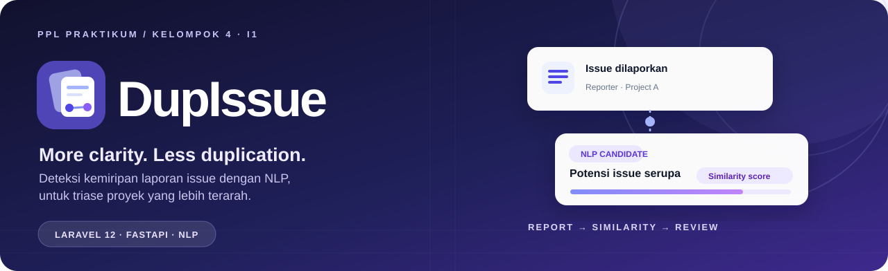
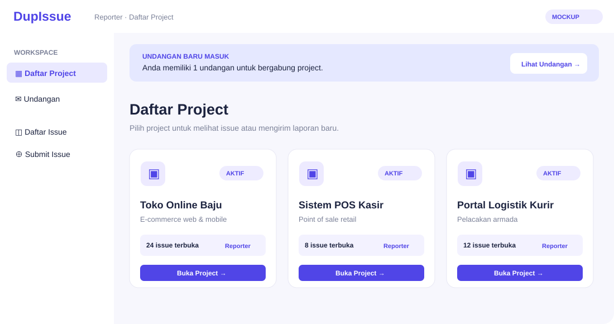
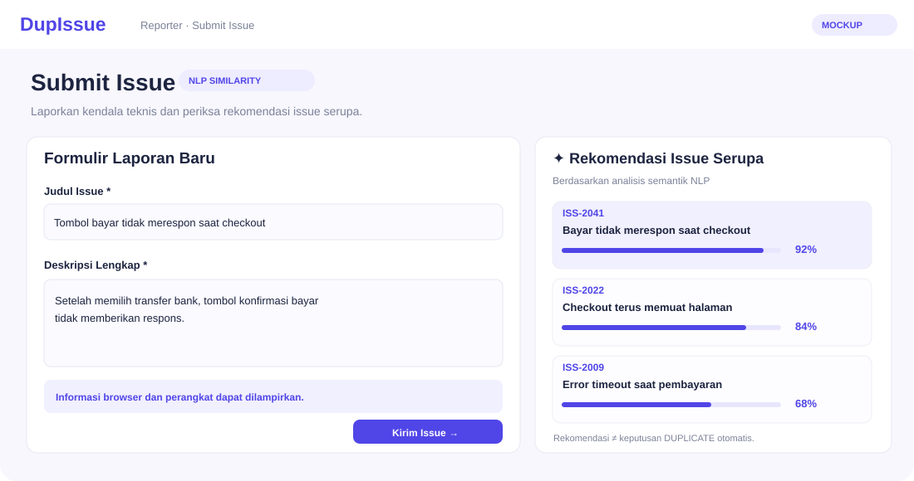
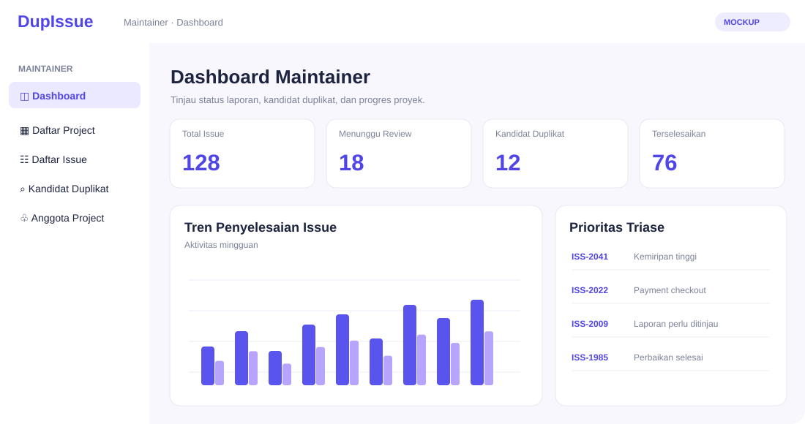
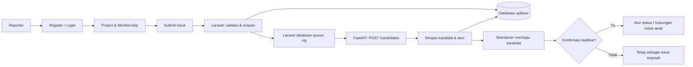

<div align="center">
  
  <p><strong>More clarity. Less duplication.</strong></p>
  <p>Satu ruang kerja untuk melaporkan issue, menemukan kandidat laporan serupa, dan membantu Maintainer melakukan triase.</p>
  <p>
    <a href="#mockup-aplikasi">Mockup aplikasi</a> ·
    <a href="#alur-kerja">Alur kerja</a> ·
    <a href="#status-pengembangan">Status pengembangan</a> ·
    <a href="#menjalankan-aplikasi">Menjalankan aplikasi</a> ·
    <a href="#pengujian-dan-evidence">Pengujian</a> ·
    <a href="docs/README.md">Dokumentasi</a>
  </p>
</div>

---

## Tentang DupIssue

**DupIssue — Sistem Deteksi Duplikasi Bug/Issue Report Berbasis NLP Semantic Similarity untuk Efisiensi Triase pada Proyek Software** adalah aplikasi pelaporan dan pengelolaan issue berbasis Laravel. **Reporter** melaporkan dan memantau issue dalam project yang diikutinya. **Maintainer** mengelola project dan anggota, meninjau kandidat kemiripan, serta mengendalikan status issue.

Layanan **FastAPI + Sentence Transformers** menghitung kemiripan semantik laporan. Hasil NLP berupa **rekomendasi kandidat**, bukan keputusan bahwa dua issue pasti duplikat. Penetapan hubungan duplikat tetap memerlukan validasi manusia oleh Maintainer.

> **Status per 4 November 2026:** Implementasi utama Sprint 1 telah berada di `main`. BDD terintegrasi sudah **46 skenario / 327 langkah PASS** pada [PR #40](https://github.com/AgilePemdigi-2026/DupIssue/pull/40), tetapi PR tersebut **masih dalam proses review** pada saat README ini disusun. Fitur Sprint 2 serta penyempurnaan activity log masih dikembangkan melalui PR terpisah. Status PR harus diperiksa kembali sebelum menyatakan fitur selesai atau telah di-merge.

## Mockup aplikasi

<table>
  <tr>
    <th align="left">Daftar Project — Reporter</th>
    <th align="left">Submit Issue + rekomendasi serupa</th>
  </tr>
  <tr>
    <td width="50%"></td>
    <td width="50%"></td>
  </tr>
</table>

<p align="center"><strong>Dashboard Maintainer — triase dan kandidat duplikat</strong></p>
<p align="center"></p>

> **Catatan:** gambar di atas merupakan **mockup rancangan**, bukan screenshot dari implementasi terbaru. Tampilan aktual dapat berbeda dan harus diverifikasi melalui aplikasi yang dijalankan.

## Alur kerja



**Pemisahan tanggung jawab:** Laravel mengelola validasi, autentikasi, hak akses project, penyimpanan dan status; FastAPI memberikan skor kemiripan. Saat pemrosesan NLP gagal, issue yang sudah disimpan tidak boleh otomatis terhapus atau dianggap duplikat.

## Status pengembangan

Ringkasan ini membedakan **kode yang sudah ada di `main`** dengan **fitur yang masih berupa Pull Request**. Status berikut merupakan snapshot pada 4 November 2026, bukan jaminan kesiapan produksi.

| Area | Kondisi yang terverifikasi | Catatan |
| --- | --- | --- |
| Register, Login, RBAC, Logout | Implementasi tersedia di `main` | Role Reporter/Maintainer dilindungi di server; pendaftaran publik tidak menentukan role Maintainer. |
| Forgot Password OTP | Implementasi tersedia di `main` | OTP enam digit, masa berlaku, pembatasan percobaan, reset password, dan notifikasi melalui queue. Gmail SMTP memerlukan konfigurasi environment dan worker sungguhan. |
| Project & Anggota | Implementasi tersedia di `main` | Pengelolaan project, undangan, membership aktif, dan pembatasan akses. |
| Submit Issue & Lihat Issue | Implementasi tersedia di `main` | Validasi form, pemisahan akses per project, dan penyimpanan issue. |
| NLP Detection sesudah Submit | Integrasi Laravel–queue–FastAPI tersedia di `main` | Proses nyata membutuhkan layanan FastAPI dan worker `nlp` yang aktif. |
| Review Duplikat & Status Issue | Endpoint keputusan dan perubahan status sudah tersedia di `main` | Penyempurnaan daftar kandidat, perbandingan, dan retry merupakan pekerjaan Sprint 2. |
| Activity Log Project (REQ-03.12) | [PR #36](https://github.com/AgilePemdigi-2026/DupIssue/pull/36) masih direview | Tabel `activity_logs` telah ada; pencatatan permanen seluruh aktivitas project belum boleh dianggap selesai sebelum PR disetujui. |
| Voting Issue | [PR #37](https://github.com/AgilePemdigi-2026/DupIssue/pull/37) masih direview | Perlu pemeriksaan otorisasi dan penanganan issue duplikat sebelum merge. |
| Review Duplikat Sprint 2 | [PR #38](https://github.com/AgilePemdigi-2026/DupIssue/pull/38) masih direview | Daftar terpusat, compare, dan retry; perlu validasi integrasi dan regression. |
| Rekomendasi Top 3 sebelum Submit | [PR #39](https://github.com/AgilePemdigi-2026/DupIssue/pull/39) masih direview | Berbeda dengan deteksi NLP **sesudah** submit. |
| BDD Sprint 1 terintegrasi | [PR #40](https://github.com/AgilePemdigi-2026/DupIssue/pull/40) sudah PASS di CI | Runner Behat tersedia pada branch PR sampai perubahan tersebut di-merge ke `main`. |

Roadmap mengikuti Scrum tiga sprint; penempatan fitur dan prioritas tetap mengikuti [Sprint Planning](docs/README.md), SRS, serta keputusan integrasi yang disepakati tim.

## Teknologi

| Komponen | Teknologi |
| --- | --- |
| Backend | PHP 8.2+ / Laravel 12 |
| Frontend | Blade, Bootstrap 5.3, JavaScript |
| Database pengembangan aplikasi | MySQL 8 |
| Queue | Laravel database queue; antrean `nlp` untuk deteksi dan `default` untuk notifikasi OTP |
| Email | Laravel Notifications + SMTP (misalnya Gmail SMTP, jika dikonfigurasi) |
| Layanan NLP | Python 3.12 / FastAPI |
| Model kemiripan | `sentence-transformers/paraphrase-multilingual-MiniLM-L12-v2` |
| Pengujian | Laravel PHPUnit, Behat + Mink, Python unittest, GitHub Actions |
| Kolaborasi | GitHub Issues, feature branches, Pull Requests, code review |

## Struktur repository

```text
DupIssue/
├── backend/                 # Laravel: controller, services, models, jobs, views, routes
│   ├── app/
│   ├── database/
│   ├── features/             # Behat, pada branch BDD PR #40
│   ├── resources/views/
│   ├── routes/
│   └── tests/
├── nlp-service/             # FastAPI, model NLP dan unit test
├── docs/
│   ├── bdd/                 # Skenario Gherkin
│   ├── artifacts/           # Rancangan dan sumber diagram
│   ├── testing/             # Panduan dan evidence pengujian
│   ├── decisions.md
│   └── README.md
└── README.md
```

## Menjalankan aplikasi

### 1. Instalasi Laravel dan database

**Prasyarat:** PHP 8.2+ beserta ekstensi yang dibutuhkan Laravel, Composer, Node.js/npm, dan MySQL 8. Contoh ini memakai **PowerShell Windows**.

```powershell
git clone https://github.com/AgilePemdigi-2026/DupIssue.git
cd DupIssue\backend
composer install
npm.cmd install
Copy-Item .env.example .env
php artisan key:generate
```

Siapkan database MySQL kosong, lalu atur file **lokal** `backend/.env`:

```dotenv
APP_NAME=DupIssue
APP_ENV=local
APP_URL=http://127.0.0.1:8000

DB_CONNECTION=mysql
DB_HOST=127.0.0.1
DB_PORT=3306
DB_DATABASE=dupissue
DB_USERNAME=YOUR_LOCAL_DB_USER
DB_PASSWORD=YOUR_LOCAL_DB_PASSWORD

QUEUE_CONNECTION=database
NLP_SERVICE_URL=http://127.0.0.1:8001
```

`DB_USERNAME` dan `DB_PASSWORD` di atas adalah **placeholder**, bukan kredensial yang bisa langsung digunakan. Jangan meng-commit `.env`, `APP_KEY`, App Password Gmail, token, atau informasi sensitif lainnya.

```powershell
php artisan migrate
php artisan serve --no-reload
```

Jalankan Vite dari terminal kedua di direktori `backend`:

```powershell
npm.cmd run dev
```

Buka [halaman utama](http://127.0.0.1:8000/), [Register](http://127.0.0.1:8000/register), atau [Login](http://127.0.0.1:8000/login). Pendaftaran publik membuat akun Reporter; akun Maintainer tidak diberikan melalui manipulasi form Register.

> **Keamanan:** `php artisan migrate` digunakan untuk menerapkan migration aplikasi. **Jangan menjalankan `migrate:fresh` pada MySQL development yang berisi data tim.** Jangan memakai contoh `.env` testing untuk aplikasi development sungguhan.

### 2. Menjalankan FastAPI NLP

Dari folder `nlp-service`, pada terminal baru:

```powershell
py -3.12 -m venv .venv
.\.venv\Scripts\python.exe -m pip install -r requirements.txt
.\.venv\Scripts\python.exe -m uvicorn main:app --host 127.0.0.1 --port 8001
```

Port `8001` menghindari bentrok dengan Laravel di `8000`. Periksa `http://127.0.0.1:8001/health` atau dokumentasi `http://127.0.0.1:8001/docs`. Unduhan model dapat diperlukan pada penggunaan pertama. Lihat [NLP README](nlp-service/README.md) dan [API Contract](nlp-service/API_CONTRACT.md).

### 3. Mengaktifkan queue NLP dan email OTP

Dari folder `backend`, buka **dua terminal tambahan** dan jalankan secara terpisah:

```powershell
# Terminal worker NLP
php artisan queue:work database --queue=nlp --tries=3
```

```powershell
# Terminal worker notifikasi OTP
php artisan queue:work database --queue=default --tries=1
```

Pengiriman OTP nyata membutuhkan **mailer SMTP yang valid**, bukan `MAIL_MAILER=log` atau `MAIL_MAILER=array`. Untuk Gmail SMTP, konfigurasi yang relevan di `.env` meliputi `MAIL_MAILER=smtp`, host/port SMTP, alamat pengirim, username, dan **App Password** yang disimpan secara lokal. Tidak ada kredensial Gmail yang disimpan pada repository. Setelah perubahan `.env`, pastikan konfigurasi aplikasi dan worker menggunakan nilai terbaru, lalu uji pengiriman pada inbox yang dikuasai tim.

**Perbedaan pengujian dan produksi:** BDD menggunakan `Notification::fake()` untuk memeriksa logika OTP tanpa mengirim email; pengiriman email melalui Gmail SMTP nyata harus diverifikasi terpisah. Demikian juga, BDD mengganti HTTP FastAPI dengan fake yang deterministik; pengujian integrasi NLP langsung memerlukan service dan worker aktif.

## Pengujian dan evidence

### Laravel PHPUnit

Dari `backend`, jalankan:

```powershell
php artisan test
```

Konfigurasi PHPUnit memaksa `APP_ENV=testing`, **SQLite in-memory** dan pemeriksaan database sebelum migration. Pastikan ekstensi `pdo_sqlite` aktif dan Laravel config tidak di-cache. Jika ada peringatan `.env` tidak ditemukan pada worktree baru, siapkan **`.env` lokal yang aman untuk testing**; jangan menyalin rahasia dari environment lain atau menyembunyikan warning.

**Evidence lokal pada branch integrasi BDD, 4 November 2026:** `214 passed`, `2 skipped`, `1.232 assertions`, exit code `0`. Angka ini berasal dari run yang dilaporkan pada checkout integrasi dan tidak otomatis menjadi bukti hasil pada semua branch yang berbeda.

### Behat BDD (PR #40)

Pada branch `integration/bdd-sprint1` (hingga PR #40 di-merge), tersedia:

```powershell
cd backend
powershell -NoProfile -ExecutionPolicy Bypass -File .\run-bdd-sprint1.ps1
```

| Suite | Skenario | Langkah | Hasil |
| --- | ---: | ---: | --- |
| Register | 7 | 39 | PASS |
| Submit Issue, NLP, Issue Status, Logout, Project & Members | 27 | 243 | PASS |
| Login/RBAC dan Forgot Password OTP | 12 | 45 | PASS |
| **Total** | **46** | **327** | **PASS** |

Ketiga suite menggunakan **database SQLite `:memory:`**, bukan MySQL development. Bukti CI tersedia pada [GitHub Actions Run #41809280743](https://github.com/AgilePemdigi-2026/DupIssue/actions/runs/41809280743), commit `b691b70` dari [PR #40](https://github.com/AgilePemdigi-2026/DupIssue/pull/40). Seluruh tiga job step pengujian sukses; artifact run menyimpan log masing-masing suite.

> **Batas cakupan:** Behat menguji alur aplikasi dengan SMTP dan HTTP NLP yang di-fake. Lolos BDD **bukan** bukti SMTP atau model FastAPI live telah diuji pada deployment. Status `2 skipped` pada PHPUnit harus tetap dicatat, bukan dihitung sebagai PASS.

### Python NLP dan build frontend

Dari folder `nlp-service`, jalankan dengan environment Python yang sesuai:

```powershell
.\.venv\Scripts\python.exe -m unittest discover -s tests -v
```

Dari `backend`, build frontend:

```powershell
npm.cmd run build
```

Catat setiap run berdasarkan **branch, commit SHA, tanggal, environment, PASS/FAIL/SKIPPED, dan tautan evidence**. Jangan menyatakan skenario Gherkin yang hanya ditulis sebagai Behat PASS sebelum dieksekusi.

## Dokumentasi dan artefak

- [Indeks dokumentasi](docs/README.md)
- [Struktur artefak rancangan](docs/artifacts/README.md)
- [Skenario BDD](docs/bdd/)
- [Panduan evidence pengujian](docs/testing/README.md)
- [Keputusan teknis](docs/decisions.md)
- [NLP API Contract](nlp-service/API_CONTRACT.md)
- [PR #40 — BDD Sprint 1](https://github.com/AgilePemdigi-2026/DupIssue/pull/40)

Untuk PPL Praktikum, dokumentasikan **working software**, SRS, use case, user story & scenario, rancangan GUI/database, sumber diagram **PlantUML `.puml`**, bukti pengujian BDD, progress sprint, serta hasil review Product Owner. Screenshot/PDF tidak menggantikan sumber diagram atau log hasil tes. Pembagian minggu dan artefak mengikuti [panduan dokumentasi tim](docs/README.md) dan panduan praktikum yang berlaku.

## Alur kolaborasi

1. Ambil `origin/main` terbaru dan buat branch yang spesifik untuk satu fitur atau dokumentasi.
2. Implementasikan perubahan sesuai SRS dan kontrak integrasi; koordinasikan perubahan route, skema, queue, serta izin akses lintas fitur.
3. Jalankan targeted tests dan regression sesuai perubahan; simpan evidence aktual.
4. Periksa `git status`, `git diff`, dan pastikan file rahasia tidak ikut commit.
5. Push branch, ajukan Pull Request ke `main`, lalu tunggu review dan required checks sebelum merge.
6. Sesudah merge, perbarui dokumentasi dan sinkronkan branch lain dengan `main` terbaru.

Gunakan [template Pull Request](.github/PULL_REQUEST_TEMPLATE.md). Hindari klaim “selesai” hanya berdasarkan status PR yang masih Open, dokumentasi `.feature`, atau hasil pengujian dari snapshot berbeda.

## Tim

| Anggota | Tanggung jawab Sprint 1 |
| --- | --- |
| Joshua Charis Giovanni Mangialu | Project Manager & Technical Lead; Register, Login & RBAC, koordinasi integrasi dan BDD |
| Valentino Kevin Iversen | Deteksi kemiripan NLP dan integrasi layanan |
| Elsa Alfika Dyah K. P. | Logout dan Submit Issue |
| Fakhri Reza Abinaya | Mengelola Project & Anggota |

---

<p align="center">
  
  <br />
  <sub><strong>DupIssue</strong> · Kelompok 4 / I1 · PPL Praktikum · Universitas Airlangga · 2026</sub>
</p>
