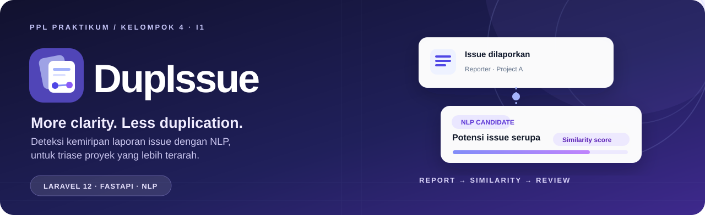
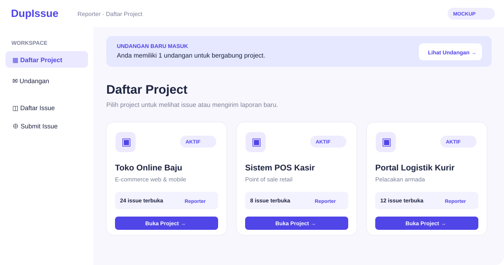
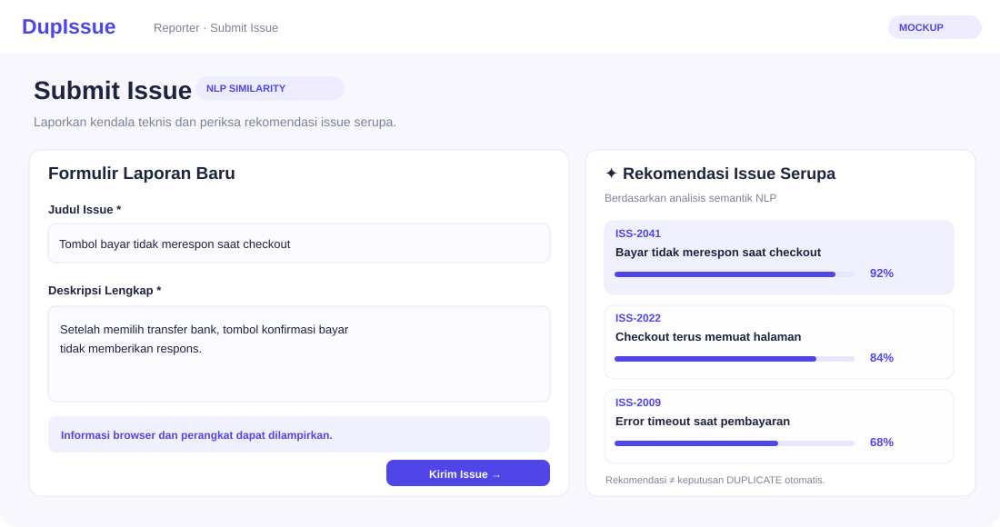
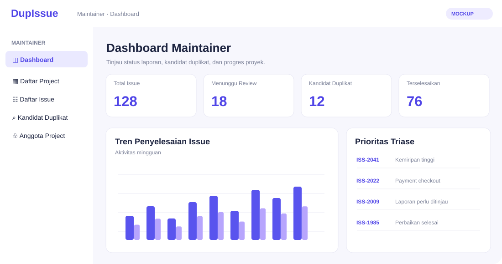
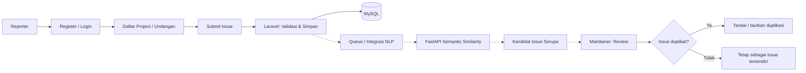

<div align="center">
  
  <p><strong>More clarity. Less duplication.</strong></p>
  <p>Satu ruang kerja untuk melaporkan issue, menemukan kandidat laporan serupa, dan membantu Maintainer melakukan triase.</p>
  <p>
    <a href="#lihat-rancangan-aplikasinya"><strong>Lihat rancangan UI</strong></a> ·
    <a href="#alur-kerja">Alur kerja</a> ·
    <a href="#menjalankan-aplikasi">Cara menjalankan</a> ·
    <a href="docs/README.md">Dokumentasi</a>
  </p>
</div>

---

## Tentang DupIssue

**Sistem Deteksi Duplikasi Bug/Issue Report Berbasis NLP Semantic Similarity untuk Efisiensi Triase pada Proyek Software**

Proyek mata kuliah **Praktikum Pembangunan Perangkat Lunak (PPL Prak)** — Kelas I1, Kelompok 4, Program Studi Sistem Informasi, Universitas Airlangga (2026).

DupIssue membantu Reporter melaporkan dan memantau issue dalam suatu project, sementara Maintainer mengelola project, melakukan triase, dan memvalidasi kandidat issue duplikat. Layanan NLP memberikan **skor kemiripan semantik**, bukan keputusan duplikasi otomatis.

> **Status:** Pengembangan bertahap dengan Scrum (3 sprint). Fitur Register serta Login & RBAC telah terintegrasi di `main`. Halaman tujuan role masih berupa placeholder; modul project, issue, dan integrasi NLP sedang dikembangkan.

## Navigasi

- [Lihat rancangan aplikasinya](#lihat-rancangan-aplikasinya)
- [Alur kerja](#alur-kerja)
- [Fitur dan roadmap](#fitur-dan-roadmap)
- [Teknologi](#teknologi)
- [Struktur repository](#struktur-repository)
- [Menjalankan aplikasi](#menjalankan-aplikasi)
- [Pengujian](#pengujian)
- [Dokumentasi dan artefak](#dokumentasi-dan-artefak)
- [Alur kolaborasi](#alur-kolaborasi)
- [Tim](#tim)

## Lihat rancangan aplikasinya

<table>
  <tr>
    <th align="left">Daftar Project — Reporter</th>
    <th align="left">Submit Issue + rekomendasi serupa</th>
  </tr>
  <tr>
    <td width="50%"></td>
    <td width="50%"></td>
  </tr>
</table>

<p align="center"><strong>Dashboard Maintainer — triase dan kandidat duplikat</strong></p>
<p align="center"></p>

> **Keterangan galeri:** ilustrasi vektor di atas **diadaptasi dari konsep Data Mockup UTS Kelompok 4** untuk memperkenalkan tampilan yang direncanakan. **Bukan screenshot aplikasi yang sudah berjalan.** Halaman Project, Submit Issue, dan Dashboard final masih dalam pengembangan. Setelah implementasinya tersedia dan diuji, ilustrasi dapat diganti screenshot aplikasi sesungguhnya beserta evidence-nya.

## Alur kerja

DupIssue dirancang untuk mendukung proses **Reporter mengirim issue → sistem mencari kandidat mirip → Maintainer meninjau duplikasi**. Autentikasi Register dan Login/RBAC sudah terintegrasi; **alur issue dan Laravel–FastAPI di bawah menunjukkan target integrasi proyek, bukan klaim semua tahap sudah berjalan di `main`.**



**Prinsip utama:** skor NLP merupakan **rekomendasi kemiripan**. Penetapan status `DUPLICATE` tetap merupakan keputusan Maintainer, bukan perubahan otomatis oleh model.

## Fitur dan roadmap

| Sprint | Fitur | Kondisi saat dokumentasi ini disusun |
| --- | --- | --- |
| 1 | Register | Terintegrasi di `main` |
| 1 | Login & Hak Akses (Reporter/Maintainer) | Terintegrasi di `main`; dashboard masih placeholder |
| 1 | Logout, Project & Anggota, Submit Issue | Dalam pengembangan/integrasi tim |
| 1 | Deteksi Kemiripan NLP | API FastAPI tersedia; integrasi Laravel belum dinyatakan selesai |
| 2 | Lihat Status Issue, Rekomendasi Issue Serupa, Vote Issue, Review & Validasi Duplikat | Direncanakan |
| 3 | Mengelola Sumber Issue, Mengelola Status Issue, Dashboard Statistik, Riwayat & Log | Direncanakan |

Roadmap mengacu pada Sprint Planning Kelompok 4. Status harus diperbarui saat fitur benar-benar selesai, diuji, dan di-merge.

## Teknologi

| Komponen | Teknologi |
| --- | --- |
| Backend web dan autentikasi | PHP 8.2+ / Laravel 12 |
| Antarmuka saat ini | Laravel Blade, Bootstrap 5.3, JavaScript |
| Database aplikasi | MySQL 8 |
| NLP service | Python 3.12, FastAPI |
| Semantic similarity | Sentence Transformers: `paraphrase-multilingual-MiniLM-L12-v2` |
| Pengujian backend | Laravel Feature Test / PHPUnit |
| Skenario BDD | Gherkin; eksekusi Behat memerlukan runner dan bukti tersendiri |
| Kolaborasi | GitHub Issues, feature branches, Pull Requests, code review |

## Struktur repository

```text
DupIssue/
├── backend/                 # Aplikasi Laravel 12
│   ├── app/
│   ├── database/
│   ├── resources/views/
│   ├── routes/
│   └── tests/
├── nlp-service/             # FastAPI, model NLP, kontrak API, unit test
├── docs/
│   ├── bdd/                 # Skenario Gherkin yang telah dibuat
│   ├── artifacts/           # Panduan & lokasi artefak perancangan
│   ├── testing/             # Panduan penyimpanan bukti pengujian
│   ├── decisions.md         # Keputusan dan isu teknis
│   └── README.md            # Indeks dokumentasi
└── README.md
```

## Menjalankan aplikasi

### A. Persiapan Laravel dan MySQL

**Prasyarat:** PHP 8.2+, Composer, Node.js/npm, MySQL 8. Contoh perintah berikut menggunakan PowerShell (Windows).

1. Clone dan masuk ke folder backend:

   ```powershell
   git clone https://github.com/AgilePemdigi-2026/DupIssue.git
   cd DupIssue/backend
   composer install
   npm.cmd install
   Copy-Item .env.example .env
   php artisan key:generate
   ```

2. Buat database kosong bernama `dupissue` melalui MySQL Workbench atau alat MySQL lainnya. Sesuaikan konfigurasi database pada `backend/.env`:

   ```dotenv
   APP_NAME=DupIssue
   APP_URL=http://127.0.0.1:8000

   DB_CONNECTION=mysql
   DB_HOST=127.0.0.1
   DB_PORT=3306
   DB_DATABASE=dupissue
   DB_USERNAME=root
   DB_PASSWORD=
   ```

   `DB_USERNAME` dan `DB_PASSWORD` adalah contoh; gunakan kredensial MySQL lokal masing-masing. **Jangan commit `.env`.** File `.env.example` bawaan Laravel masih menggunakan SQLite sebagai default sehingga perlu disesuaikan untuk database aplikasi DupIssue.

3. Buat tabel dan jalankan server:

   ```powershell
   php artisan migrate
   php artisan serve --no-reload
   ```

   Pada terminal **terpisah**, dari folder `backend`, jalankan:

   ```powershell
   npm.cmd run dev
   ```

   Buka:
   - Register: http://127.0.0.1:8000/register
   - Login: http://127.0.0.1:8000/login

   Akun yang terdaftar secara publik saat ini mendapat role awal **REPORTER**. Pembuatan akun **MAINTAINER** dan aturan keanggotaan project harus mengikuti keputusan serta integrasi tim; jangan mengubah role melalui input form Register.

### B. Menjalankan layanan NLP (terpisah)

**Prasyarat:** Python 3.12 dan koneksi internet saat model pertama kali diunduh.

Dari folder `nlp-service`:

```powershell
py -3.12 -m venv .venv
.\.venv\Scripts\python.exe -m pip install -r requirements.txt
.\.venv\Scripts\python.exe -m uvicorn main:app --host 127.0.0.1 --port 8001
```

Untuk pengembangan bersamaan, contoh di atas menggunakan port **8001** agar tidak bentrok dengan Laravel pada port **8000**. Dokumentasi NLP tersendiri memakai port 8000 jika dijalankan sendiri. Endpoint NLP meliputi `GET /health`, `POST /similarity`, dan `POST /candidates`.

Rincian penggunaan: [NLP README](nlp-service/README.md) dan [API Contract](nlp-service/API_CONTRACT.md).

**Penting:** keberadaan API NLP belum berarti antrean dan integrasi Laravel–FastAPI sudah selesai. Hasil NLP tidak boleh otomatis mengubah status issue menjadi duplikat tanpa aturan bisnis dan keputusan Maintainer.

## Pengujian

Dari folder `backend`:

```powershell
php artisan test --filter=RegisterTest
php artisan test --filter=LoginTest
php artisan test
npm.cmd run build
```

Konfigurasi `backend/phpunit.xml` menggunakan **SQLite `:memory:`** untuk pengujian. Pastikan ekstensi `pdo_sqlite` aktif; jangan menjalankan pengujian yang memodifikasi database pengembangan yang berisi data nyata.

Untuk NLP, dari `nlp-service` dengan environment Python aktif:

```powershell
.\.venv\Scripts\python.exe -m unittest discover -s tests -v
```

File `.feature` di [docs/bdd](docs/bdd/) adalah skenario Gherkin. **PASS pada Laravel Feature Test tidak otomatis berarti Behat PASS.** Simpan hasil eksekusi runner BDD ketika sudah dijalankan, termasuk tanggal, perintah, hasil, dan bukti.

## Dokumentasi dan artefak

- [Indeks dokumentasi](docs/README.md)
- [Panduan penempatan artefak perancangan](docs/artifacts/README.md)
- [Skenario BDD](docs/bdd/)
- [Panduan bukti pengujian](docs/testing/README.md)
- [Catatan keputusan teknis](docs/decisions.md)
- [Kontrak API NLP](nlp-service/API_CONTRACT.md)

Sesuai Panduan Program Monitoring PPL Praktikum, artefak perancangan (terutama **sumber teks PlantUML** untuk diagram), user story dan scenario, GUI, database, serta **bukti eksekusi BDD** harus didokumentasikan untuk UAS. Berkas SRS, Sprint Planning, dan mockup dapat ditambahkan di lokasi yang dijelaskan pada indeks dokumentasi. PDF saja **tidak menggantikan** sumber diagram `.puml` dan bukti uji.

## Alur kolaborasi

1. Sinkronkan `main` terbaru dan buat branch fitur sendiri, misalnya `feature/submit-issue`.
2. Implementasikan fitur mengikuti SRS, kontrak yang disepakati, dan GitHub Issue.
3. Tambahkan atau perbarui artefak, pengujian, serta dokumentasi fitur.
4. Jalankan test yang relevan, pastikan tidak ada rahasia (`.env`, token, kredensial) yang ikut di-commit.
5. Push branch dan buat **Pull Request ke `main`**; lakukan review sebelum merge.
6. Setelah merge, anggota lain mengambil perubahan dari `main`.

Gunakan [Pull Request template](.github/PULL_REQUEST_TEMPLATE.md) untuk memudahkan penelusuran implementasi dan bukti uji. Perubahan API, route, skema, dan aturan hak akses yang memengaruhi anggota lain harus disepakati sebelum merge.

## Tim

| Anggota | Tanggung jawab Sprint 1 |
| --- | --- |
| Joshua Charis Giovanni Mangialu | Project Manager & Technical Lead; Register, Login & RBAC |
| Valentino Kevin Iversen | Deteksi Kemiripan NLP |
| Elsa Alfika Dyah K. P. | Logout dan Submit Issue |
| Fakhri Reza Abinaya | Mengelola Project & Anggota |

---

<p align="center">
  
  <br />
  <sub><strong>DupIssue</strong> · Kelompok 4 / I1 · PPL Praktikum · Universitas Airlangga · 2026</sub>
</p>
