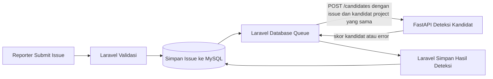

# DupIssue NLP Service — API Contract (Sprint 1)

Dokumen ini memisahkan **kontrak endpoint yang sudah diimplementasikan** dari **rancangan integrasi Laravel–FastAPI** yang masih perlu disepakati dan dikerjakan. Contoh dan detail kontrak di bawah dicocokkan dengan model Pydantic serta handler dalam `main.py`.

## Status dan cakupan

- FastAPI menyediakan `GET /health`, `POST /similarity`, dan `POST /candidates`.
- Model Sentence Transformers `sentence-transformers/paraphrase-multilingual-MiniLM-L12-v2` berjalan di CPU dan dimuat saat aplikasi mulai.
- Kontrak ini mendokumentasikan perilaku NLP saat ini. Belum ada integrasi Laravel, MySQL, antrean, autentikasi layanan, penyimpanan hasil, atau callback.
- Kemiripan adalah skor, **bukan** keputusan duplikasi otomatis.
- Cakupan hanya alur deteksi kandidat sesudah issue disimpan. Tidak mencakup rekomendasi Top 3 sebelum submit atau fitur Sprint 2 lainnya.

## Konvensi umum

- Format body dan respons: JSON (`Content-Type: application/json` untuk request dengan body).
- Base URL lokal untuk pengembangan: `http://127.0.0.1:8000`. URL lingkungan integrasi/produksi belum ditetapkan.
- Endpoint saat ini tidak meminta kredensial atau token autentikasi.
- Pada FastAPI, `title` dan `description` harus berupa string yang tidak kosong setelah spasi di awal/akhir dibuang. Nilai yang diterima di-strip sebelum pemrosesan teks.
- `issue_id` dan `project_id` menerima string atau integer JSON, tetapi bukan boolean. ID string yang hanya berisi spasi ditolak; integer diterima sebagaimana adanya.
- Field yang diwajibkan oleh model harus ada. Request tidak valid ditolak FastAPI/Pydantic sebelum fungsi endpoint berjalan.
- Teks issue disusun secara konsisten menjadi `Title: <title>\nDescription: <description>` sebelum embedding.

### Validasi bisnis SRS (tanggung jawab Laravel)

SRS menetapkan `title` sepanjang **5–200 karakter** dan `description` sepanjang **10–10.000 karakter**. Laravel harus memvalidasi batas ini saat menerima issue sebelum menyimpannya. Implementasi FastAPI saat ini **belum menegakkan batas panjang tersebut**; FastAPI hanya memvalidasi keberadaan field, tipe string, dan bahwa title/description tidak kosong setelah strip. Jangan menganggap HTTP 200 dari FastAPI sebagai bukti bahwa batas panjang SRS sudah dipenuhi.

## Endpoint yang sudah diimplementasikan

### `GET /health`

**Fungsi:** pemeriksaan sederhana bahwa aplikasi HTTP merespons. Respons tidak menunjukkan readiness model secara terpisah.

**Request:** tidak ada body.

**Respons `200 OK`:**

```json
{
  "status": "ok",
  "service": "DupIssue NLP Service"
}
```

### `POST /similarity`

**Fungsi:** menghitung cosine similarity antara dua issue. Endpoint ini tidak menentukan apakah keduanya duplikat.

Validasi di endpoint ini mengikuti model FastAPI yang dijelaskan di atas dan tidak menerapkan batas panjang title/description SRS; validasi bisnis tetap tanggung jawab Laravel.

**Request wajib:**

| Field                                      | Tipe JSON | Wajib | Validasi                         |
| ------------------------------------------ | --------- | ----: | -------------------------------- |
| `issue1`                                   | object    |    Ya | Berisi `title` dan `description` |
| `issue2`                                   | object    |    Ya | Berisi `title` dan `description` |
| `issue1.title`, `issue2.title`             | string    |    Ya | Tidak kosong setelah strip       |
| `issue1.description`, `issue2.description` | string    |    Ya | Tidak kosong setelah strip       |

Contoh request:

```json
{
  "issue1": {
    "title": "Tidak bisa masuk",
    "description": "Login gagal setelah kredensial dimasukkan."
  },
  "issue2": {
    "title": "Masalah saat login",
    "description": "Pengguna tidak dapat masuk setelah memasukkan kata sandi."
  }
}
```

**Respons sukses `200 OK`:**

| Field        | Tipe JSON | Arti                                       |
| ------------ | --------- | ------------------------------------------ |
| `similarity` | number    | Skor cosine similarity yang dihitung model |

Contoh respons:

```json
{
  "similarity": 0.882
}
```

Tidak ada threshold yang diterapkan oleh endpoint ini. Jangan menafsirkan skor sebagai status `DUPLICATE` tanpa aturan bisnis yang disepakati Maintainer.

Cosine similarity yang dikembalikan adalah skor mentah dari algoritma; secara matematis nilainya dapat berada pada rentang **-1 sampai 1**, termasuk nilai negatif. SRS menyebut kolom skor pada `duplicate_candidates` dibatasi **0–1**. **PENDING TEAM DECISION:** kebijakan representasi dan penyimpanan skor belum disepakati. Alternatif yang dapat dipertimbangkan adalah menyimpan skor mentah dengan menyesuaikan constraint database, atau menggunakan transformasi skor yang terdokumentasi dan disepakati. Tidak ada alternatif yang dipilih atau diterapkan; FastAPI tidak meng-clamp atau mentransformasi skor. **Joshua dan Valentino perlu menyepakati kebijakan ini sebelum integrasi penyimpanan hasil NLP.**

### `POST /candidates`

**Fungsi:** membandingkan issue baru dengan daftar kandidat yang dikirim pemanggil, lalu mengurutkan skor similarity menurun. Pemanggil perlu menyediakan kandidat; endpoint belum membaca database.

Laravel bertanggung jawab mengambil daftar kandidat dari MySQL dan mengirimkannya pada request. FastAPI hanya memvalidasi payload, memproses teks, menghitung similarity, serta menyaring dan mengurutkan kandidat di dalam daftar yang diterima. FastAPI tidak mengambil issue atau kandidat dari MySQL. Batas panjang title/description SRS divalidasi oleh Laravel, bukan FastAPI.

**Request wajib:**

| Field                      | Tipe JSON           | Wajib | Validasi                                          |
| -------------------------- | ------------------- | ----: | ------------------------------------------------- |
| `project_id`               | string atau integer |    Ya | String tidak boleh kosong setelah strip           |
| `new_issue`                | object              |    Ya | Wajib memiliki `issue_id`, `title`, `description` |
| `new_issue.issue_id`       | string atau integer |    Ya | String tidak boleh kosong setelah strip           |
| `new_issue.title`          | string              |    Ya | Tidak kosong setelah strip                        |
| `new_issue.description`    | string              |    Ya | Tidak kosong setelah strip                        |
| `candidates`               | array object        |    Ya | Boleh berupa array kosong                         |
| `candidates[].issue_id`    | string atau integer |    Ya | String tidak boleh kosong setelah strip           |
| `candidates[].project_id`  | string atau integer |    Ya | String tidak boleh kosong setelah strip           |
| `candidates[].title`       | string              |    Ya | Tidak kosong setelah strip                        |
| `candidates[].description` | string              |    Ya | Tidak kosong setelah strip                        |

Contoh request valid:

```json
{
  "project_id": "project-a",
  "new_issue": {
    "issue_id": "issue-100",
    "title": "Aplikasi gagal saat login",
    "description": "Terjadi error setelah pengguna memasukkan kredensial."
  },
  "candidates": [
    {
      "issue_id": "issue-101",
      "project_id": "project-a",
      "title": "Tidak bisa masuk ke aplikasi",
      "description": "Login gagal setelah kredensial dimasukkan."
    },
    {
      "issue_id": "issue-202",
      "project_id": "project-b",
      "title": "Masalah login",
      "description": "Issue ini milik project lain dan akan diabaikan."
    }
  ]
}
```

**Respons sukses `200 OK`:**

| Field                     | Tipe JSON           | Arti                                                      |
| ------------------------- | ------------------- | --------------------------------------------------------- |
| `candidates`              | array object        | Hasil kandidat valid, diurutkan dari similarity tertinggi |
| `candidates[].issue_id`   | string atau integer | ID kandidat sebagaimana diterima                          |
| `candidates[].similarity` | number              | Skor cosine similarity                                    |

Contoh respons:

```json
{
  "candidates": [
    {
      "issue_id": "issue-101",
      "similarity": 0.882
    }
  ]
}
```

Skor di respons adalah cosine similarity mentah. Rentang matematisnya **-1 sampai 1**, sedangkan SRS membatasi kolom skor `duplicate_candidates` pada **0 sampai 1**. **PENDING TEAM DECISION:** sebelum hasil disimpan, Joshua dan Valentino perlu menyepakati apakah constraint database disesuaikan agar menerima skor mentah atau apakah digunakan transformasi skor yang terdokumentasi. Belum ada kebijakan yang dipilih; FastAPI tidak melakukan clamping otomatis atau transformasi.

Jika array kosong, semua kandidat berbeda project, atau semua kandidat memiliki ID sama dengan issue baru, respons adalah `200 OK` dengan `{"candidates": []}`. Model tidak dipanggil jika tidak ada kandidat eligible.

#### Filter kandidat

Endpoint hanya menghitung similarity untuk kandidat yang `project_id`-nya sama dengan `project_id` request. Kandidat dengan `issue_id` sama dengan `new_issue.issue_id` dikecualikan. Perbandingan ID dilakukan dengan mengubah nilai ke string terlebih dahulu; oleh karena itu integer `12` dan string `"12"` dianggap sama. Kandidat project lain atau ID yang sama tidak muncul di hasil. Hasil yang tersisa diurutkan menurun berdasarkan skor. Tidak ada threshold dan tidak ada batas Top 3.

## Status HTTP dan error yang diterapkan

| Status                     | Kondisi                                                                                                                                                                                                                                 |
| -------------------------- | --------------------------------------------------------------------------------------------------------------------------------------------------------------------------------------------------------------------------------------- |
| `200 OK`                   | Health check merespons; similarity berhasil dihitung; atau candidates berhasil diproses (termasuk jika hasilnya kosong).                                                                                                                |
| `422 Unprocessable Entity` | Body JSON tidak valid untuk model Pydantic: field wajib hilang, tipe salah, atau title/description/ID/project ID string kosong. Error validasi dibuat oleh FastAPI/Pydantic sebelum inferensi model.                                    |
| `503 Service Unavailable`  | Endpoint similarity/candidates gagal saat mengakses model, membuat embedding, atau menghitung cosine similarity. Body generik: `{"detail":"Similarity service is temporarily unavailable."}`. Detail exception tidak dikirim ke client. |

Kegagalan pemuatan model pada startup saat ini dicatat ke log dan menggagalkan startup dengan `RuntimeError` generik (`NLP model could not be loaded.`); karena server tidak berhasil mulai, hal ini bukan respons HTTP 503. `GET /health` hanya memastikan HTTP handler merespons dan belum menjadi pemeriksaan readiness model.

### Status pemrosesan NLP (rancangan SRS/Laravel, belum diimplementasikan)

Empat status proses yang perlu digunakan dan transisinya dikelola Laravel:

| Status       | Makna rancangan                                                                                                        |
| ------------ | ---------------------------------------------------------------------------------------------------------------------- |
| `PENDING`    | Issue sudah tersimpan dan menunggu job deteksi diproses.                                                               |
| `PROCESSING` | Queue worker sedang memproses job/panggilan NLP.                                                                       |
| `COMPLETED`  | Deteksi kandidat berhasil dan hasilnya sudah ditangani/disimpan Laravel. Hasil kosong tetap dapat berstatus completed. |
| `FAILED`     | Deteksi gagal setelah kebijakan retry yang disepakati; issue utama tetap tersimpan.                                    |

Status ini bukan field request/response endpoint NLP saat ini. FastAPI belum membuat atau mengubah status tersebut; state machine, penyimpanan status, dan retry adalah tanggung jawab integrasi Laravel yang belum dikerjakan. Transisi persis, termasuk kapan menandai `FAILED`, perlu disepakati tim.

## Rancangan integrasi Sprint 1 — belum diimplementasikan

Alur sasaran koordinasi:



1. Reporter mengirim issue ke Laravel.
2. Laravel memvalidasi payload dan menyimpan issue utama ke MySQL terlebih dahulu.
3. Setelah transaksi penyimpanan berhasil, Laravel mengirim job ke database queue.
4. Worker Laravel mengambil issue tersimpan dan mengambil kandidat pembanding dari MySQL untuk project yang sama. Worker menyiapkan `project_id`, issue baru, serta kandidat tersebut; worker memanggil FastAPI `POST /candidates`.
5. FastAPI mengembalikan skor kandidat, atau status error layanan.
6. Laravel menyimpan hasil deteksi dan status pemrosesan ke MySQL. Kegagalan NLP tidak boleh membatalkan/menghapus issue yang telah tersimpan.

Diagram ini adalah rancangan integrasi. Queue, penyimpanan, worker, pembacaan kandidat MySQL, payload aktual Laravel, dan mekanisme hasil **belum dibuat** dalam proyek NLP ini. FastAPI hanya menerima teks dan ID di payload, lalu menghitung similarity; pengambilan kandidat dari database dilakukan Laravel.

### Konfigurasi alamat FastAPI di Laravel (rekomendasi)

Simpan base URL FastAPI dalam konfigurasi environment Laravel, misalnya `NLP_SERVICE_URL=http://127.0.0.1:8000`, lalu baca melalui konfigurasi aplikasi Laravel (bukan hard-code di job/controller). Nilai default tersebut hanya sesuai jika Laravel dan FastAPI berjalan pada **komputer yang sama**. `127.0.0.1`/`localhost` selalu menunjuk ke komputer tempat proses Laravel berjalan; jika FastAPI ada di laptop lain, gunakan alamat IP LAN atau hostname FastAPI yang dapat dijangkau dari komputer Laravel, serta pastikan server bind ke interface yang sesuai, firewall/jaringan mengizinkan koneksi, dan pengaturan keamanan/TLS disepakati. Alamat, port, dan metode akses aktual belum ditetapkan.

## Pembagian tanggung jawab yang diusulkan

### Laravel (rancangan, belum diimplementasikan di sini)

- Menangani autentikasi/otorisasi pengguna, validasi domain dan kepemilikan project.
- Menyimpan issue secara transaksional ke MySQL sebelum memulai deteksi.
- Memilih dan mengirim kandidat untuk project yang sama; FastAPI tetap melakukan filter defensif.
- Menjalankan panggilan HTTP melalui database queue, mengatur timeout/retry/backoff, dan mencatat status pemrosesan.
- Menyimpan respons similarity dan error yang dapat dipulihkan; menjaga hasil tidak menggandakan catatan pada retry.
- Memastikan kegagalan deteksi tidak menghilangkan issue yang telah diterima.

### FastAPI (implementasi yang tersedia)

- Memvalidasi bentuk payload sesuai model Pydantic.
- Menormalisasi spasi pada title/description dengan strip, menyusun teks secara konsisten, membuat embedding menggunakan model yang dimuat saat startup, dan menghitung cosine similarity.
- Pada `/candidates`, menerapkan filter project dan mengecualikan ID issue yang sama, lalu mengurutkan skor menurun.
- Mengembalikan skor dan tidak menetapkan status duplikasi, menyimpan data, mengakses Laravel/MySQL, maupun mengelola antrean.

## Timeout, retry, dan kegagalan NLP (rekomendasi untuk disepakati)

Ketentuan ini adalah rekomendasi integrasi, bukan fitur yang sudah dikonfigurasi pada API:

- Panggilan Laravel → FastAPI harus menggunakan timeout koneksi dan timeout total yang terbatas. Tetapkan nilainya setelah mengukur waktu inferensi CPU dan ukuran kandidat realistis; nilai belum disepakati.
- Retry hanya untuk kegagalan sementara, misalnya timeout/koneksi terputus atau HTTP `503`, dengan jumlah terbatas dan exponential backoff. Hindari retry pada `422` karena payload harus diperbaiki.
- Job sebaiknya idempotent agar retry tidak membuat duplikasi hasil. Definisikan kunci unik/strategi upsert setelah skema database disepakati.
- Simpan issue lebih dahulu. Jika FastAPI tetap gagal setelah retry, tandai pekerjaan sebagai gagal/tertunda untuk retry manual/terjadwal dan pertahankan issue; jangan menghapus atau menolak issue yang telah tersimpan.
- Catat error operasional yang aman (waktu, issue/job ID, status HTTP, correlation ID), tetapi jangan menyimpan kredensial atau mengembalikan stack trace internal kepada client.
- `503` pada request endpoint berarti operasi similarity gagal dan tidak ada daftar hasil yang sah. Pemanggil tidak boleh menyimpan hasil kandidat palsu dari respons tersebut.
- Pemuatan model gagal membuat proses FastAPI tidak siap start. Laravel perlu memantau ketersediaan layanan dan menjaga job dalam antrean jika tidak dapat menghubungi layanan.

## Target performa SRS (belum diverifikasi)

Target SRS adalah deteksi kandidat selesai dalam **maksimal 60 detik** untuk project dengan hingga **5.000 issue**, dengan queue worker aktif. Ini adalah target end-to-end yang belum dibuktikan melalui pengujian performa. Belum ada benchmark pada dataset/mesin deployment, pengukuran waktu antre, atau jaminan bahwa seluruh kandidat akan diproses dalam target. Laravel mengambil kandidat dari MySQL; ukuran payload, waktu query, waktu antre, dan inferensi CPU semuanya perlu diperhitungkan dalam pengujian integrasi/performa.

## Keputusan untuk disepakati dengan Joshua dan Elsa

Belum ada keputusan tim yang tercermin dalam implementasi saat ini. Sepakati dan catat:

1. **Format ID:** apakah issue/project ID integer database, UUID/string, atau format lain; aturan normalisasi; dan apakah `12` serta `"12"` seharusnya setara (implementasi NLP saat ini menyamakannya).
2. **Skema database:** tabel/kolom issue dan hasil deteksi, relasi project, penyimpanan skor, constraint unik/idempotency key, timestamp, serta retention hasil.
3. **Payload dan kontrak:** nama field dan struktur Laravel final, apakah mengirim semua kandidat atau membatasi di sisi Laravel, ukuran maksimum daftar/payload, dan apakah kelak perlu versi API. Saat ini seluruh kandidat eligible dihitung dan tidak ada Top 3 atau threshold.
4. **Status pemrosesan NLP:** nama status resmi SRS adalah `PENDING`, `PROCESSING`, `COMPLETED`, dan `FAILED` (nama-nama ini sudah ditetapkan). Tim masih perlu menyepakati mekanisme transisi antarstatus, kapan retry dilakukan, dan kondisi akhir `FAILED` setelah retry habis. Pengelolaan status merupakan tanggung jawab Laravel dan belum diimplementasikan.
5. **Aturan keputusan Maintainer:** bagaimana skor ditampilkan dan ditinjau. Keputusan `DUPLICATE` tetap kewenangan Maintainer; jangan menetapkan threshold atau status otomatis sebelum aturan bisnis disahkan.
6. **Queue/retry:** queue connection, jumlah retry, backoff, timeout worker/request, dead-letter atau prosedur retry manual, dan strategi idempotensi.
7. **Konfigurasi layanan:** nilai `NLP_SERVICE_URL` per komputer/environment, host/port, bind interface, jaringan (khususnya jika berbeda laptop), TLS, autentikasi service-to-service, secret management, health/readiness probe, logging, dan correlation ID. `http://127.0.0.1:8000` hanya default untuk satu komputer.
8. **Kapasitas/performa:** cara memenuhi target SRS maksimal 60 detik untuk project hingga 5.000 issue dengan queue worker aktif; definisi awal/akhir pengukuran; jumlah kandidat yang dikirim per request; perilaku batching/pagination bila diperlukan; serta kebutuhan concurrency/worker. Target tersebut belum teruji.
9. **Kebijakan penyimpanan skor similarity:** PENDING TEAM DECISION. Joshua dan Valentino perlu menyepakati apakah skor cosine similarity mentah disimpan dengan menyesuaikan constraint database atau menggunakan transformasi skor yang terdokumentasi. Keputusan harus dibuat sebelum implementasi penyimpanan hasil NLP.
10. **Validasi dan tanggung jawab:** Laravel menegakkan batas SRS title 5–200 dan description 10–10.000 karakter; FastAPI saat ini hanya cek keberadaan/tipe/tidak kosong. Sepakati apakah perlu validasi panjang defensif juga di FastAPI di masa mendatang.
11. **Operasional dan privasi:** pemilik alert, monitoring model/startup, log yang boleh disimpan, serta kebijakan pengiriman data issue ke layanan NLP.

Sebelum kesepakatan tersebut, gunakan kontrak endpoint yang terdokumentasi di atas sebagai batas perilaku FastAPI saat ini; detail integrasi yang belum diputuskan tidak boleh diasumsikan sebagai fitur tersedia.
